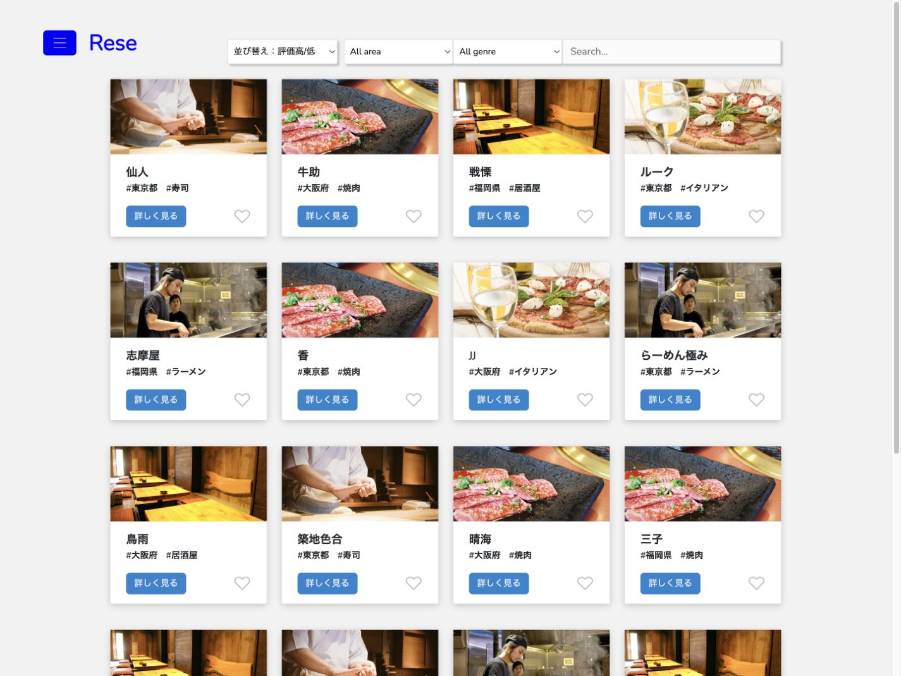
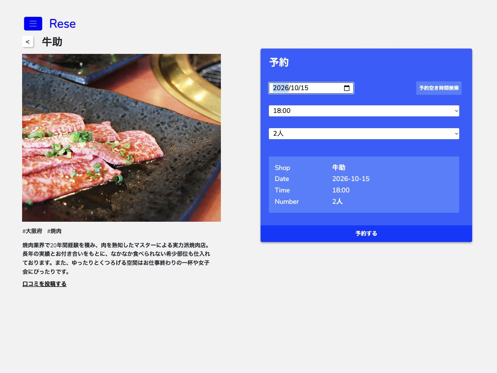
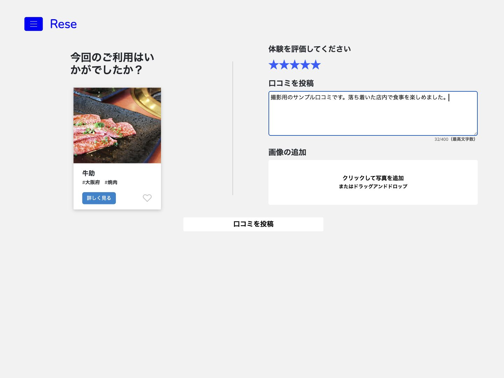
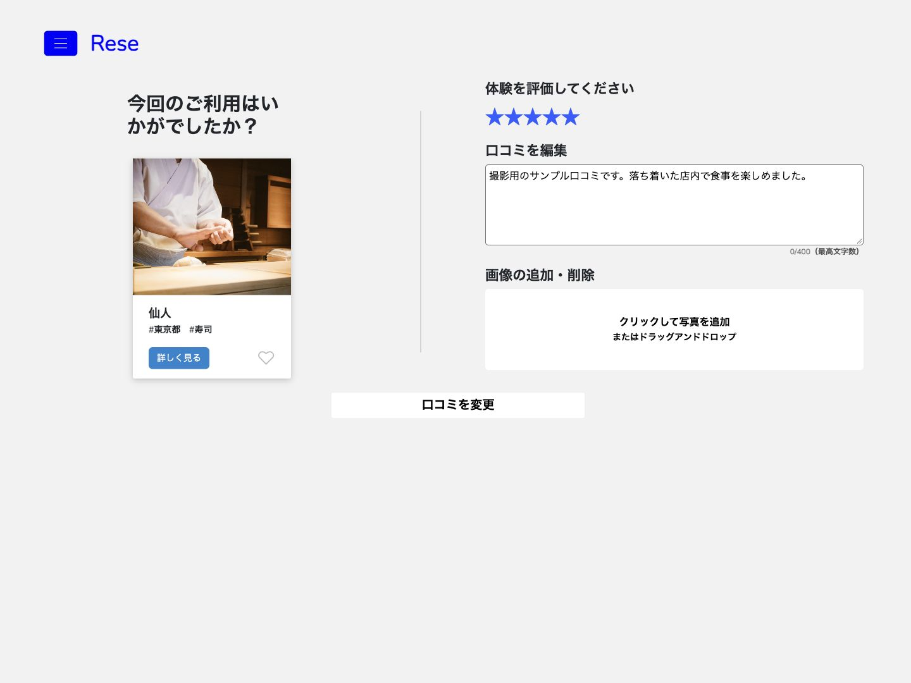
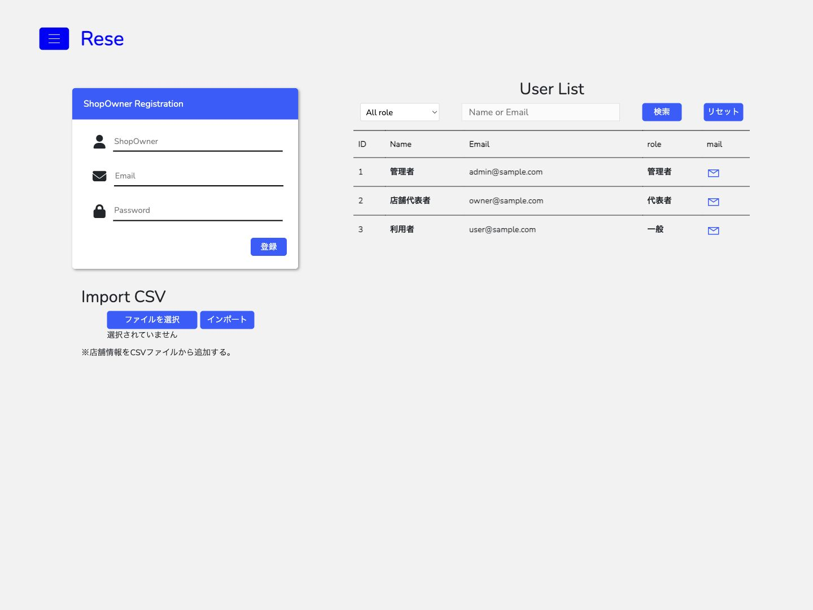
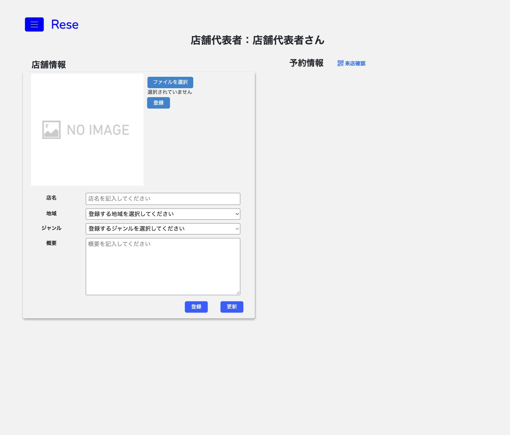
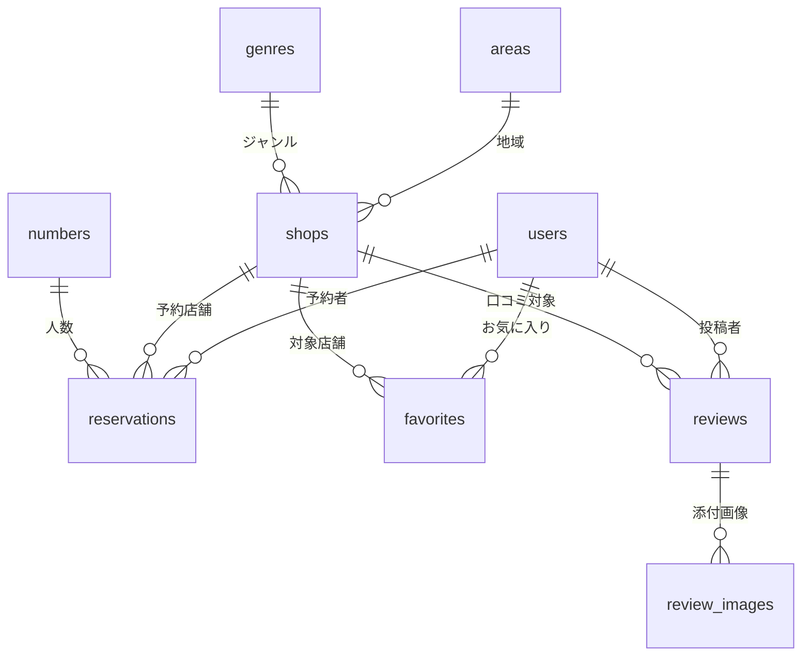

# Rese（飲食店予約アプリ）

飲食店の検索・予約・口コミ投稿から、店舗代表者による店舗管理、管理者によるCSVインポートまでを実装した予約アプリです。
「外部サービスの手数料を抑えるため、自社で予約サービスを持ちたい」という要望を想定して制作した学習作品です。

**現在の公開状況**：現在はAWS環境に接続しておらず、アプリのオンライン公開を停止しています。アクセス可能な公開ドメイン・デモURLはありません。画面は以下のスクリーンショットで確認でき、動作を試す場合は[環境構築](#環境構築)の手順でローカル環境を起動できます。



[画面紹介](#画面紹介) · [主な機能](#主な機能) · [実装のポイント](#実装のポイント) · [データベース設計](#データベース設計) · [環境構築](#環境構築) · [ローカルでの確認方法](#ローカルでの確認方法)

## 画面紹介

現在のコードと同梱のデモデータを使い、ローカル環境で撮影した画面です。口コミの入力例は撮影用のサンプルです。

### 店舗詳細・予約フォーム

店舗の写真・地域・ジャンル・紹介文を表示し、日付・時間・人数を選んで予約できます。



<details>
<summary>口コミ・管理者・店舗代表者の画面を見る</summary>

### 口コミの投稿

星評価、400文字以内のコメント、JPEG・PNGの画像を入力できます。



### 口コミの編集

保存した星評価とコメントを引き継いで編集します。添付画像の追加・削除にも対応しています。



### 管理者の画面

店舗代表者の登録、CSVによる店舗情報の追加、ユーザー検索、メール送信の入口をまとめています。



### 店舗代表者の画面

店舗情報・写真の登録と更新、予約情報の確認、QRコードによる来店確認の入口を表示します。画像は店舗登録前の初期状態です。



</details>

## 主な機能

| 利用者 | 機能 |
| --- | --- |
| ゲスト | 店舗一覧の閲覧、地域・ジャンル・店舗名での検索 |
| 一般ユーザー | 会員登録・メール認証・ログイン・ログアウト、店舗詳細、お気に入り、予約 |
| 一般ユーザー | マイページでの予約変更・キャンセル・決済、口コミの投稿・編集・削除 |
| 店舗代表者 | 店舗情報・画像の登録と更新、予約一覧、時間帯別の予約枠と予約間隔の設定、QRコードによる来店確認、利用者へのメール送信 |
| 管理者 | 店舗代表者の登録、ユーザーの検索、CSVインポート、利用者へのメール送信、口コミの削除 |

### 口コミと並び替え

- 星評価は1〜5、コメントは400文字以内、添付画像はJPEG・PNGに対応しています。
- 一般ユーザーは1店舗につき1件の口コミを投稿し、自分の投稿を編集・削除できます。
- 管理者は店舗の口コミ一覧から口コミを削除できます。
- 店舗一覧はランダム・評価が高い順・評価が低い順に並び替えられます。評価がない店舗は評価順の最後に表示します。

### CSVインポート

管理者はUTF-8のCSVから店舗情報を追加できます。項目・入力条件・ローカル画像の指定方法は[CSVインポートの手順](docs/csv-import.md)を参照してください。AWSを使わず、同梱の店舗画像で試す方法も記載しています。

### 予約・来店確認

- 予約時に受付用QRコードのリンクをメールで送信します。
- スケジューラーで予約当日のリマインダーを送信します。
- 店舗代表者はQRコードを読み取り、来店確認の状態を更新します。
- 予約空き時間検索は、店舗代表者が登録し予約枠を設定した店舗が対象です。同梱のデモ店舗には対応していません。
- クレジットカード決済はStripeのテスト環境を使用します。

## 実装のポイント

- **認証と役割の管理**：Laravel Fortifyで認証・メール認証を実装し、Spatie Laravel Permissionで一般ユーザー・店舗代表者・管理者の役割を管理しています。([ルート定義](src/routes/web.php)、[デモユーザーと権限](src/database/seeders/UserPermissionSeeder.php))
- **口コミと画像の分離**：口コミ本文・星評価を`reviews`、添付画像を`review_images`で管理。編集時には保存済みの入力内容を取得します。([口コミ処理](src/app/Http/Controllers/ReviewController.php))
- **CSVの入力検証と一括登録**：店舗名・地域・ジャンル・概要・画像パスを検証し、入力エラーがあればトランザクションをロールバックする実装です。([インポート処理](src/app/Http/Controllers/ImportController.php)、[CSVの入力条件](src/app/Imports/ShopsImport.php))
- **予約と店舗運用の連携**：利用者の予約と、店舗代表者の予約一覧・来店確認・時間帯別の枠設定をつなげています。([予約処理](src/app/Http/Controllers/ReservationController.php)、[店舗管理](src/app/Http/Controllers/RegisteredShopController.php))
- **定期処理**：予約当日の案内を毎朝8時に送るスケジュールを設定しています。([スケジューラー](src/app/Console/Kernel.php))

## 使用技術

| 区分 | 技術 |
| --- | --- |
| バックエンド | PHP 8.2.19、Laravel 8.83.27、Laravel Fortify、Spatie Laravel Permission |
| フロントエンド | Blade、HTML / CSS、JavaScript、Bootstrap、Livewire、Laravel Mix |
| 開発環境 | Docker Compose、MySQL 8.0.35、nginx 1.22.1、MailHog、phpMyAdmin、cron |
| CSV・QRコード・決済 | Laravel Excel、Simple QrCode / jsQR、Stripe（テスト環境） |
| 過去に構築したAWS環境（現在は非公開） | EC2、RDS、S3、独自ドメインでのHTTPS接続 |

依存関係とバージョンは[composer.lock](src/composer.lock)、[package-lock.json](src/package-lock.json)、[Docker構成](docker-compose.yml)を参照してください。

## データベース設計

マイグレーションから再作成した主要テーブルの関係です。店舗画像・予約枠・権限管理を含むER図と19テーブルのカラム・制約は[データベース設計](docs/database.md)にまとめています。



## 環境構築

Docker DesktopとGitを使用します。以下は、画面確認用の開発環境を初めて構築する手順です。

### 1. リポジトリの取得

```bash
git clone https://github.com/kazuhitotakao/Rese.git
cd Rese
cp src/.env.example src/.env
```

### 2. 開発用の設定

`src/.env`を以下の設定にします。DBの値は`docker-compose.yml`の開発用設定に対応しています。

```dotenv
APP_NAME=Rese
APP_ENV=local
APP_URL=http://localhost

DB_CONNECTION=mysql
DB_HOST=mysql
DB_PORT=3306
DB_DATABASE=laravel_db
DB_USERNAME=laravel_user
DB_PASSWORD=laravel_pass

MAIL_MAILER=smtp
MAIL_HOST=mailhog
MAIL_PORT=1025
MAIL_USERNAME=null
MAIL_PASSWORD=null
MAIL_ENCRYPTION=null
MAIL_FROM_ADDRESS=info@example.com
MAIL_FROM_NAME="${APP_NAME}"
```

### 3. 起動と初期データの作成

```bash
docker compose up -d --build
docker compose exec php composer install --no-dev
docker compose exec php php artisan key:generate
docker compose exec php php artisan migrate --seed
docker compose exec php php artisan storage:link
```

この手順は画面確認に必要な実行用パッケージをインストールします。テスト用などの開発依存は含めていません。
MySQLの起動直後に接続エラーが出る場合は、起動完了後にマイグレーションを再実行してください。`storage`と`bootstrap/cache`はPHPの実行ユーザーが書き込める権限にします。
表示用のCSS・JavaScriptは`src/public`に含まれています。

店舗写真は`src/public/images`に同梱し、シーディング時の`APP_URL`から画像URLを登録します。既存DBに保存済みの画像URLは、設定変更だけでは更新されません。

## ローカルでの確認方法

現在、AWS上のアプリや旧独自ドメインでの公開デモは提供していません。以下は環境構築後、自分のPCで開くためのURLです。

| 確認する内容 | ローカル環境のURL |
| --- | --- |
| ログイン | http://localhost/login |
| 会員登録 | http://localhost/register |
| ゲストの店舗一覧 | http://localhost/guest |
| ログイン後の店舗一覧 | http://localhost/ |
| マイページ | http://localhost/my-page |
| phpMyAdmin | http://localhost:8080/ |
| 認証メール・予約メールの確認（MailHog） | http://localhost:8025/ |

### デモアカウント

初回のシーディングで作成されます。パスワードはすべて`password`です。デモアカウントはメール認証済みとして登録されるため、そのままログインできます。

| 役割 | メールアドレス |
| --- | --- |
| 管理者 | admin@sample.com |
| 店舗代表者 | owner@sample.com |
| 一般ユーザー | user@sample.com |

新たに会員登録した場合は、MailHogで認証メールを開き、メールアドレスを認証してください。店舗代表者はメニューの「Shop Info」、管理者は「Admin Page」から各画面を開けます。

### Stripeのテスト決済

決済を試す場合は`src/.env`に自分のStripeテスト用キーを追加します。

```dotenv
STRIPE_PUBLIC_KEY=
STRIPE_SECRET_KEY=
```

テスト用カードは[Stripe公式ドキュメント](https://docs.stripe.com/testing?locale=ja-JP)を参照してください。ログインや店舗一覧・口コミの画面確認には決済キーは不要です。

### リマインダーとQRコード

リマインダーはLaravelのスケジューラーとPHPコンテナのcronを使用します。予約当日の8時の処理を確認する場合は、その時刻にコンテナとPCを起動しておく必要があります。
QRコードリーダーはブラウザのカメラ機能を使用するため、カメラを利用できる接続環境が必要です。過去のAWS環境では独自ドメインによるHTTPSを使用していました。

## ディレクトリ構成

```text
docker/                     nginx・PHP・MySQL・cronの開発用設定
docs/                       画面画像・ER図・テーブル定義・CSV操作手順
src/app/Http/Controllers/    検索・予約・口コミ・店舗管理などの処理
src/app/Http/Requests/       入力値の検証
src/app/Imports/             CSVインポートの入力条件と登録処理
src/app/Models/              データ取得・保存とリレーション
src/app/Console/             定期処理とスケジュール
src/database/               マイグレーション・シーダー
src/resources/views/        Bladeテンプレート
src/routes/                 ルート定義
```
