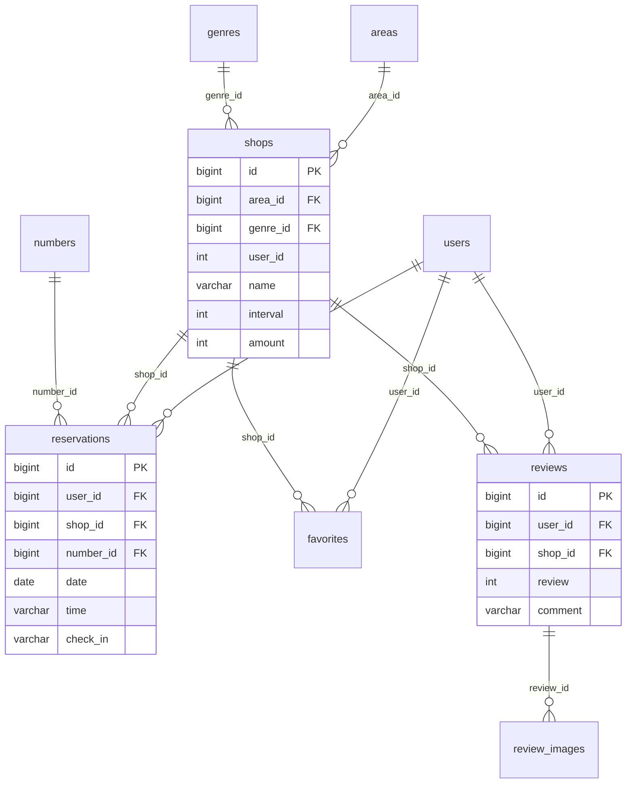
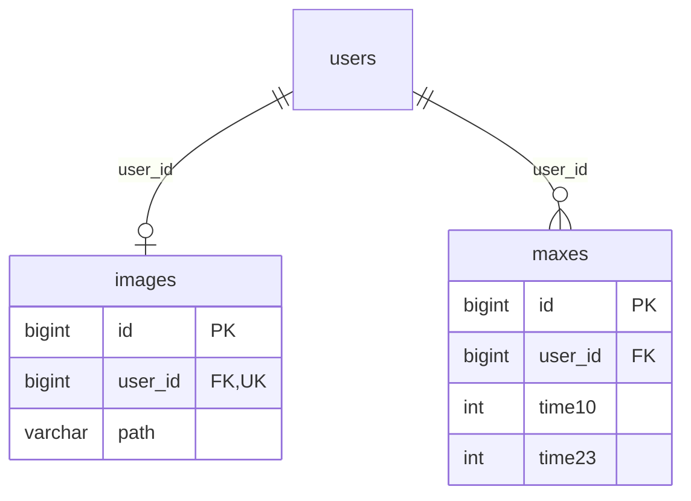
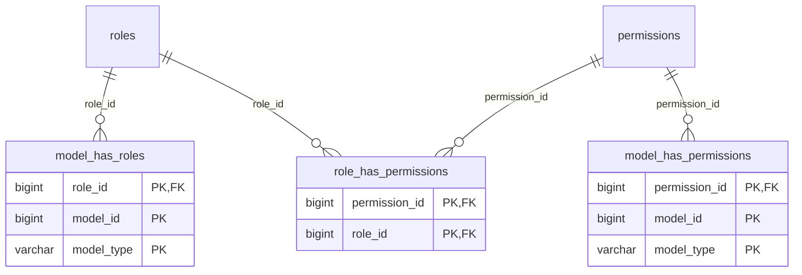

# データベース設計

定義の根拠は[src/database/migrations](../src/database/migrations)です。PHP 8.2.19・MySQL 8.0.35に全マイグレーションを適用し、作成されたカラム・インデックス・外部キーと照合しています。

業務用11テーブル、権限管理5テーブル、Laravel関連3テーブルを掲載しています。マイグレーション履歴テーブルは省略しています。

## ER図

実線はDBの外部キー制約を表します。モデル上の関連とDB制約の違いは、各図の下に記載しています。

### 店舗・予約・口コミ

`shops.user_id`は店舗代表者のユーザーIDとしてアプリから使用されますが、DBの外部キー制約はありません。口コミを1人・1店舗につき1件に制限する処理はアプリ側にあり、`reviews`に複合UNIQUE制約はありません。

### 店舗画像・時間帯別予約枠

`images.user_id`にはUNIQUE制約があります。`maxes`は10時から23時まで、各時間帯の上限を`time10`〜`time23`に保持します。両テーブルとも`shops`への外部キーは持ちません。

### 権限管理

`model_id`・`model_type`はSpatie Laravel Permissionのポリモーフィック参照です。シーダーではUserモデルにロールを付与していますが、`users`へのDB外部キー制約はありません。

## テーブル一覧

| テーブル | 用途 |
| --- | --- |
| [users](#users) | 利用者・店舗代表者・管理者 |
| [areas](#areas) | 都道府県 |
| [genres](#genres) | 飲食店ジャンル |
| [shops](#shops) | 店舗情報・画像・予約間隔・料金 |
| [numbers](#numbers) | 予約人数 |
| [reservations](#reservations) | 予約日時・人数・来店確認 |
| [favorites](#favorites) | 店舗のお気に入り |
| [reviews](#reviews) | 店舗の口コミ・星評価 |
| [review_images](#review_images) | 口コミに添付した画像 |
| [images](#images) | 店舗代表者が登録した店舗画像 |
| [maxes](#maxes) | 店舗代表者ごとの時間帯別予約枠上限 |
| [roles](#roles) | ロール |
| [permissions](#permissions) | 権限 |
| [model_has_roles](#model_has_roles) | モデルとロールの割り当て |
| [model_has_permissions](#model_has_permissions) | モデルへの直接の権限付与 |
| [role_has_permissions](#role_has_permissions) | ロールと権限の対応 |
| [password_resets](#password_resets) | パスワード再設定トークン |
| [personal_access_tokens](#personal_access_tokens) | APIトークン |
| [failed_jobs](#failed_jobs) | 失敗したジョブ |

## カラム・制約

PKは主キー、UKは単一カラムのUNIQUE、INDEXはインデックス、FKは外部キーです。複合主キー・複合UNIQUEは各テーブルの下に記載します。型はMySQLへの適用結果です。

### users

利用者・店舗代表者・管理者。

| カラム | 型 | NULL許容 | キー | 既定値 |
| --- | --- | --- | --- | --- |
| `id` | `bigint unsigned` | 不可 | PK | AUTO_INCREMENT |
| `name` | `varchar(255)` | 不可 | — | — |
| `email` | `varchar(255)` | 不可 | UK | — |
| `email_verified_at` | `timestamp` | 可 | — | NULL |
| `password` | `varchar(255)` | 不可 | — | — |
| `two_factor_secret` | `text` | 可 | — | NULL |
| `two_factor_recovery_codes` | `text` | 可 | — | NULL |
| `two_factor_confirmed_at` | `timestamp` | 可 | — | NULL |
| `remember_token` | `varchar(100)` | 可 | — | NULL |
| `created_at` | `timestamp` | 可 | — | NULL |
| `updated_at` | `timestamp` | 可 | — | NULL |

- PRIMARY KEY：`id`
- UNIQUE：`email`

### areas

都道府県。

| カラム | 型 | NULL許容 | キー | 既定値 |
| --- | --- | --- | --- | --- |
| `id` | `bigint unsigned` | 不可 | PK | AUTO_INCREMENT |
| `name` | `varchar(255)` | 不可 | — | — |
| `created_at` | `timestamp` | 可 | — | NULL |
| `updated_at` | `timestamp` | 可 | — | NULL |

- PRIMARY KEY：`id`

### genres

飲食店ジャンル。

| カラム | 型 | NULL許容 | キー | 既定値 |
| --- | --- | --- | --- | --- |
| `id` | `bigint unsigned` | 不可 | PK | AUTO_INCREMENT |
| `name` | `varchar(255)` | 不可 | UK | — |
| `created_at` | `timestamp` | 可 | — | NULL |
| `updated_at` | `timestamp` | 可 | — | NULL |

- UNIQUE：`name`
- PRIMARY KEY：`id`

### shops

店舗情報・画像・予約間隔・料金。

| カラム | 型 | NULL許容 | キー | 既定値 |
| --- | --- | --- | --- | --- |
| `id` | `bigint unsigned` | 不可 | PK | AUTO_INCREMENT |
| `name` | `varchar(255)` | 不可 | — | — |
| `area_id` | `bigint unsigned` | 不可 | INDEX, FK | — |
| `genre_id` | `bigint unsigned` | 不可 | INDEX, FK | — |
| `overview` | `varchar(255)` | 可 | — | NULL |
| `image` | `varchar(255)` | 可 | — | NULL |
| `user_id` | `int` | 可 | — | NULL |
| `interval` | `int` | 不可 | — | 15 |
| `amount` | `int` | 可 | — | 3000 |
| `average_rating` | `int` | 可 | — | NULL |
| `created_at` | `timestamp` | 可 | — | NULL |
| `updated_at` | `timestamp` | 可 | — | NULL |

- PRIMARY KEY：`id`
- FK：`area_id` → `areas.id`（削除時：NO ACTION）
- FK：`genre_id` → `genres.id`（削除時：NO ACTION）

### numbers

予約人数。

| カラム | 型 | NULL許容 | キー | 既定値 |
| --- | --- | --- | --- | --- |
| `id` | `bigint unsigned` | 不可 | PK | AUTO_INCREMENT |
| `number` | `varchar(255)` | 不可 | — | — |
| `created_at` | `timestamp` | 可 | — | NULL |
| `updated_at` | `timestamp` | 可 | — | NULL |

- PRIMARY KEY：`id`

### reservations

予約日時・人数・来店確認。

| カラム | 型 | NULL許容 | キー | 既定値 |
| --- | --- | --- | --- | --- |
| `id` | `bigint unsigned` | 不可 | PK | AUTO_INCREMENT |
| `user_id` | `bigint unsigned` | 不可 | INDEX, FK | — |
| `shop_id` | `bigint unsigned` | 不可 | INDEX, FK | — |
| `date` | `date` | 不可 | — | — |
| `time` | `varchar(255)` | 不可 | — | — |
| `number_id` | `bigint unsigned` | 不可 | INDEX, FK | — |
| `check_in` | `varchar(255)` | 可 | — | NULL |
| `check_in_at` | `timestamp` | 可 | — | NULL |
| `created_at` | `timestamp` | 可 | — | NULL |
| `updated_at` | `timestamp` | 可 | — | NULL |

- PRIMARY KEY：`id`
- FK：`number_id` → `numbers.id`（削除時：CASCADE）
- FK：`shop_id` → `shops.id`（削除時：CASCADE）
- FK：`user_id` → `users.id`（削除時：CASCADE）

### favorites

店舗のお気に入り。

| カラム | 型 | NULL許容 | キー | 既定値 |
| --- | --- | --- | --- | --- |
| `id` | `bigint unsigned` | 不可 | PK | AUTO_INCREMENT |
| `user_id` | `bigint unsigned` | 不可 | INDEX, FK | — |
| `shop_id` | `bigint unsigned` | 不可 | INDEX, FK | — |
| `created_at` | `timestamp` | 可 | — | NULL |
| `updated_at` | `timestamp` | 可 | — | NULL |

- PRIMARY KEY：`id`
- FK：`shop_id` → `shops.id`（削除時：CASCADE）
- FK：`user_id` → `users.id`（削除時：CASCADE）

### reviews

店舗の口コミ・星評価。

| カラム | 型 | NULL許容 | キー | 既定値 |
| --- | --- | --- | --- | --- |
| `id` | `bigint unsigned` | 不可 | PK | AUTO_INCREMENT |
| `user_id` | `bigint unsigned` | 不可 | INDEX, FK | — |
| `shop_id` | `bigint unsigned` | 不可 | INDEX, FK | — |
| `review` | `int` | 不可 | — | — |
| `comment` | `varchar(400)` | 不可 | — | — |
| `created_at` | `timestamp` | 可 | — | NULL |
| `updated_at` | `timestamp` | 可 | — | NULL |

- PRIMARY KEY：`id`
- FK：`shop_id` → `shops.id`（削除時：CASCADE）
- FK：`user_id` → `users.id`（削除時：CASCADE）

### review_images

口コミに添付した画像。

| カラム | 型 | NULL許容 | キー | 既定値 |
| --- | --- | --- | --- | --- |
| `id` | `bigint unsigned` | 不可 | PK | AUTO_INCREMENT |
| `review_id` | `bigint unsigned` | 不可 | INDEX, FK | — |
| `image_path` | `varchar(255)` | 不可 | — | — |
| `created_at` | `timestamp` | 可 | — | NULL |
| `updated_at` | `timestamp` | 可 | — | NULL |

- PRIMARY KEY：`id`
- FK：`review_id` → `reviews.id`（削除時：CASCADE）

### images

店舗代表者が登録した店舗画像。

| カラム | 型 | NULL許容 | キー | 既定値 |
| --- | --- | --- | --- | --- |
| `id` | `bigint unsigned` | 不可 | PK | AUTO_INCREMENT |
| `path` | `varchar(255)` | 不可 | — | — |
| `user_id` | `bigint unsigned` | 不可 | UK, FK | — |
| `created_at` | `timestamp` | 可 | — | NULL |
| `updated_at` | `timestamp` | 可 | — | NULL |

- UNIQUE：`user_id`
- PRIMARY KEY：`id`
- FK：`user_id` → `users.id`（削除時：CASCADE）

### maxes

店舗代表者ごとの時間帯別予約枠上限。

| カラム | 型 | NULL許容 | キー | 既定値 |
| --- | --- | --- | --- | --- |
| `id` | `bigint unsigned` | 不可 | PK | AUTO_INCREMENT |
| `user_id` | `bigint unsigned` | 不可 | INDEX, FK | — |
| `time10` | `int` | 可 | — | 5 |
| `time11` | `int` | 可 | — | 5 |
| `time12` | `int` | 可 | — | 5 |
| `time13` | `int` | 可 | — | 5 |
| `time14` | `int` | 可 | — | 5 |
| `time15` | `int` | 可 | — | 5 |
| `time16` | `int` | 可 | — | 5 |
| `time17` | `int` | 可 | — | 5 |
| `time18` | `int` | 可 | — | 5 |
| `time19` | `int` | 可 | — | 5 |
| `time20` | `int` | 可 | — | 5 |
| `time21` | `int` | 可 | — | 5 |
| `time22` | `int` | 可 | — | 5 |
| `time23` | `int` | 可 | — | 5 |
| `created_at` | `timestamp` | 可 | — | NULL |
| `updated_at` | `timestamp` | 可 | — | NULL |

- PRIMARY KEY：`id`
- FK：`user_id` → `users.id`（削除時：CASCADE）

### roles

ロール。

| カラム | 型 | NULL許容 | キー | 既定値 |
| --- | --- | --- | --- | --- |
| `id` | `bigint unsigned` | 不可 | PK | AUTO_INCREMENT |
| `name` | `varchar(255)` | 不可 | INDEX | — |
| `guard_name` | `varchar(255)` | 不可 | — | — |
| `created_at` | `timestamp` | 可 | — | NULL |
| `updated_at` | `timestamp` | 可 | — | NULL |

- PRIMARY KEY：`id`
- UNIQUE：`name`, `guard_name`

### permissions

権限。

| カラム | 型 | NULL許容 | キー | 既定値 |
| --- | --- | --- | --- | --- |
| `id` | `bigint unsigned` | 不可 | PK | AUTO_INCREMENT |
| `name` | `varchar(255)` | 不可 | INDEX | — |
| `guard_name` | `varchar(255)` | 不可 | — | — |
| `created_at` | `timestamp` | 可 | — | NULL |
| `updated_at` | `timestamp` | 可 | — | NULL |

- UNIQUE：`name`, `guard_name`
- PRIMARY KEY：`id`

### model_has_roles

モデルとロールの割り当て。

| カラム | 型 | NULL許容 | キー | 既定値 |
| --- | --- | --- | --- | --- |
| `role_id` | `bigint unsigned` | 不可 | PK, FK | — |
| `model_type` | `varchar(255)` | 不可 | PK | — |
| `model_id` | `bigint unsigned` | 不可 | PK | — |

- PRIMARY KEY：`role_id`, `model_id`, `model_type`
- FK：`role_id` → `roles.id`（削除時：CASCADE）

### model_has_permissions

モデルへの直接の権限付与。

| カラム | 型 | NULL許容 | キー | 既定値 |
| --- | --- | --- | --- | --- |
| `permission_id` | `bigint unsigned` | 不可 | PK, FK | — |
| `model_type` | `varchar(255)` | 不可 | PK | — |
| `model_id` | `bigint unsigned` | 不可 | PK | — |

- PRIMARY KEY：`permission_id`, `model_id`, `model_type`
- FK：`permission_id` → `permissions.id`（削除時：CASCADE）

### role_has_permissions

ロールと権限の対応。

| カラム | 型 | NULL許容 | キー | 既定値 |
| --- | --- | --- | --- | --- |
| `permission_id` | `bigint unsigned` | 不可 | PK, FK | — |
| `role_id` | `bigint unsigned` | 不可 | PK, FK | — |

- PRIMARY KEY：`permission_id`, `role_id`
- FK：`permission_id` → `permissions.id`（削除時：CASCADE）
- FK：`role_id` → `roles.id`（削除時：CASCADE）

### password_resets

パスワード再設定トークン。

| カラム | 型 | NULL許容 | キー | 既定値 |
| --- | --- | --- | --- | --- |
| `email` | `varchar(255)` | 不可 | INDEX | — |
| `token` | `varchar(255)` | 不可 | — | — |
| `created_at` | `timestamp` | 可 | — | NULL |

### personal_access_tokens

APIトークン。

| カラム | 型 | NULL許容 | キー | 既定値 |
| --- | --- | --- | --- | --- |
| `id` | `bigint unsigned` | 不可 | PK | AUTO_INCREMENT |
| `tokenable_type` | `varchar(255)` | 不可 | INDEX | — |
| `tokenable_id` | `bigint unsigned` | 不可 | — | — |
| `name` | `varchar(255)` | 不可 | — | — |
| `token` | `varchar(64)` | 不可 | UK | — |
| `abilities` | `text` | 可 | — | NULL |
| `last_used_at` | `timestamp` | 可 | — | NULL |
| `created_at` | `timestamp` | 可 | — | NULL |
| `updated_at` | `timestamp` | 可 | — | NULL |

- UNIQUE：`token`
- PRIMARY KEY：`id`

### failed_jobs

失敗したジョブ。

| カラム | 型 | NULL許容 | キー | 既定値 |
| --- | --- | --- | --- | --- |
| `id` | `bigint unsigned` | 不可 | PK | AUTO_INCREMENT |
| `uuid` | `varchar(255)` | 不可 | UK | — |
| `connection` | `text` | 不可 | — | — |
| `queue` | `text` | 不可 | — | — |
| `payload` | `longtext` | 不可 | — | — |
| `exception` | `longtext` | 不可 | — | — |
| `failed_at` | `timestamp` | 不可 | — | CURRENT_TIMESTAMP |

- UNIQUE：`uuid`
- PRIMARY KEY：`id`
